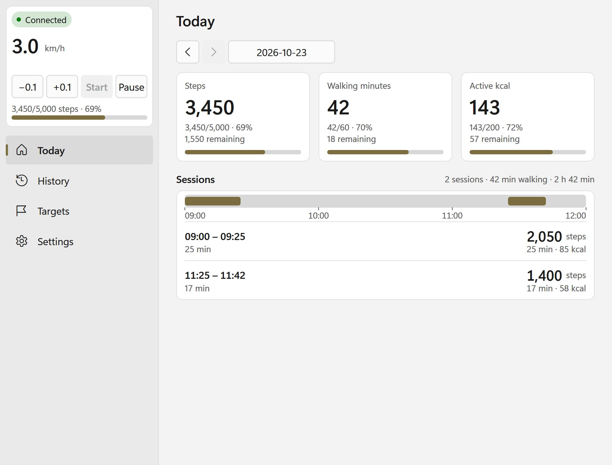
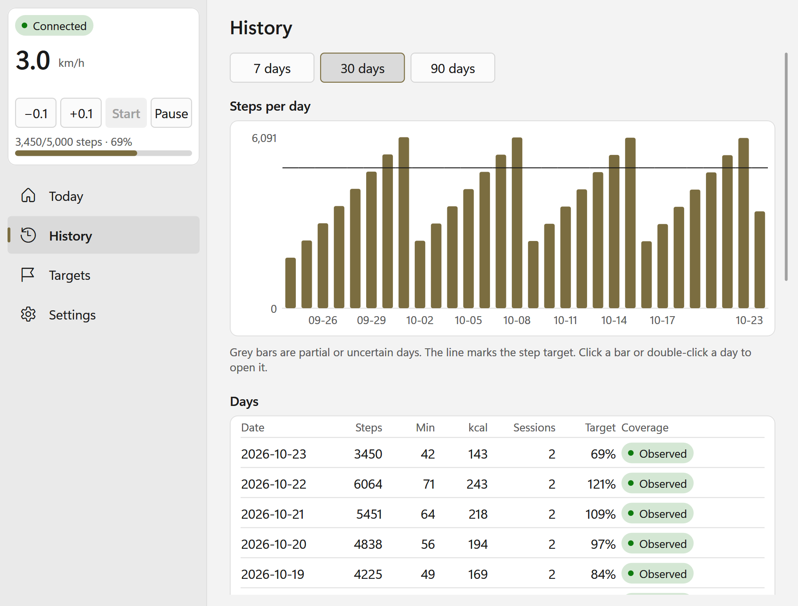
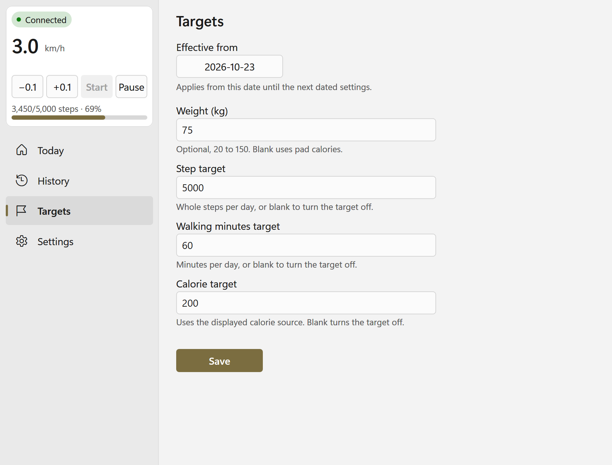
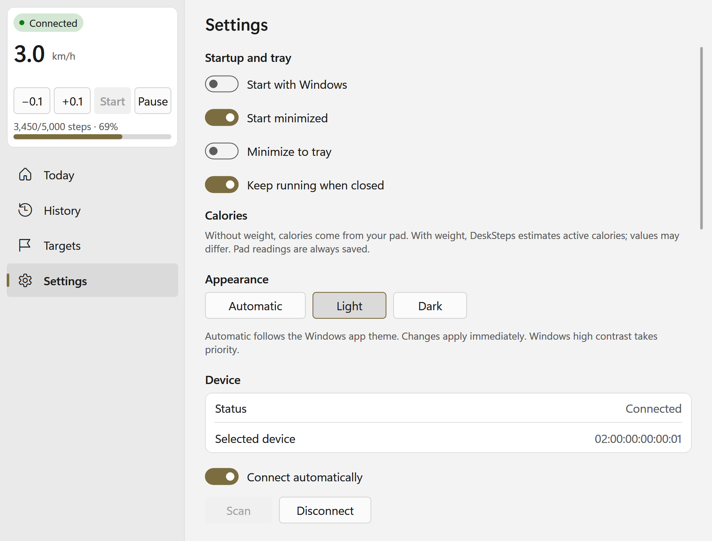
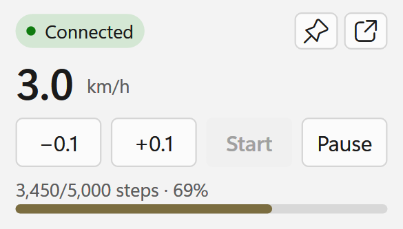

# DeskSteps

- Native Windows 11 app for KingSmith WalkingPad Z1.
- Written in Rust. No external dependencies. Single EXE file.
- Very efficient: low CPU and RAM usage.
- Private and local; no accounts, cloud or telemetry.
- Installable and portable app.

## Download

Get the Windows 11 x64 installer or portable ZIP from the
[latest release](https://github.com/georgiptr/desksteps/releases/latest).

- **Installer:** download `DeskSteps-1.0.0-windows-x64-setup.exe` and run it.
- **Portable:** extract `DeskSteps-1.0.0-windows-x64-portable.zip`, then run
  `desksteps.exe`. Keep the included `data` folder with the app; it stores your history.

Downloads are unsigned. Keep Windows security protections enabled. Release assets
include `SHA256SUMS.txt` for checking downloaded files.

See the [usage guide](docs/USAGE.md) for setup and controls, and
[data and backup guidance](docs/DATA.md) before upgrading or moving your history.

## Features

- Live steps, walking time and calories.
- Start, resume, pause and speed controls.
- Daily history, charts and walking sessions.
- Activity recovery after recording gaps.
- Daily goals and dated weight settings.
- Pad calories or estimated active calories.
- Automatic connection and reconnection.
- Saved device selection and names.
- Tray controls and an always-on-top compact remote.
- Configurable global shortcuts.
- Keyboard navigation and screen-reader support.
- Automatic, light, dark and high-contrast themes.
- Installer and portable editions.
- Offline development simulator.

## Screenshots

### Today

### History

### Targets

### Settings

### Compact remote

