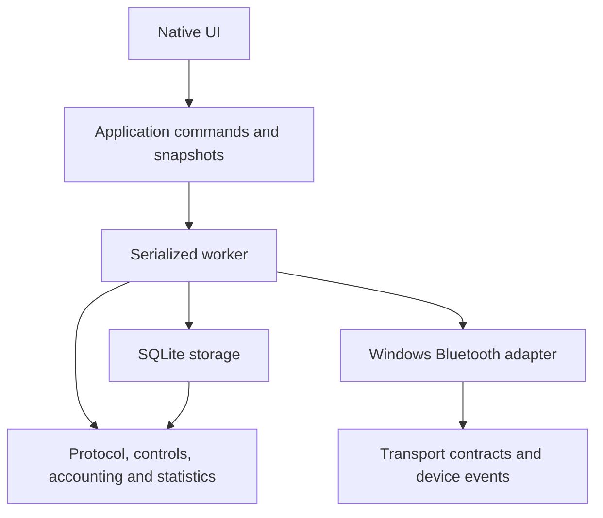

# Architecture and contributor map

DeskSteps is one Rust package with a small executable and a library containing
the implementation. `main.rs` only calls `desksteps::launch()`. All application
modules remain internal; the library is a testing and ownership boundary, not a
new public SDK.

## Finding the right module

| Change | Location |
| --- | --- |
| Arguments and offline-tool validation | `src/cli.rs` |
| Startup, storage path and timezone selection | `src/bootstrap.rs`, `src/runtime.rs` |
| Device address parsing | `src/device.rs` |
| Packet decoding and connection handshake bytes | `src/protocol.rs`, `docs/PROTOCOL.md` |
| Command encoding and protocol transaction stages | `src/control.rs` |
| Fresh speed, control eligibility, deferred Pause | `src/application/controls.rs` |
| GATT completion versus protocol replies | `src/application/exchange.rs`, `ports.rs` |
| Discovery limits and reconnect deadlines | `src/application/connection.rs` |
| Worker lifecycle and cancellation | `src/application/mod.rs`, `api.rs` |
| Event loop and production coordination | `src/application/engine.rs`, `engine/` |
| Windows BLE objects, subscriptions and cancellation | `src/application/bluetooth.rs`, `bluetooth/discovery.rs` |
| Conservative step deltas and restart-anchor decisions | `src/accounting.rs` |
| Session transitions and estimated activity | `src/statistics/` |
| SQLite schema, recording, queries and settings | `src/storage/` |
| Direct2D/DirectWrite toolkit: drawing, theme, pure layout, widgets, input | `src/ui/kit/` |
| Pure view models (live card enable rules, pages) | `src/ui/model/` |
| Main window: rail, live card, pages, status footer | `src/ui/main_window/` |
| Day, history, tile and session view models | `src/ui/model/day.rs` |
| Targets and shortcut form parsing and per-field messages | `src/ui/model/targets.rs`, `src/ui/model/shortcuts_form.rs` |
| Device choices shared by the tray and Settings | `src/ui/model/device.rs` |
| Compact remote window | `src/ui/compact/` |
| UI Automation tree and COM provider | `src/ui/main_window/access/` |
| Native text fields, form save handlers | `src/ui/main_window/forms.rs` |
| Month calendar popup | `src/ui/main_window/calendar.rs` |
| Shared movement availability checks and submission | `src/ui/actions.rs` |
| Tray, menus, hotkey registration and native message loop | `src/ui/tray/` |
| Shared native dialogs | `src/ui/dialogs.rs` |
| UTF-16/control text and owned-font cleanup | `src/ui/native.rs` |
| Synthetic offline replay | `src/replay.rs`, `tests/replay_regression.rs` |
| Database file ownership before initialization | `src/database_ownership.rs`, `src/bootstrap.rs`, `src/storage/mod.rs` |
| Real/synthetic transport selection | `src/application/transport.rs` |
| Synthetic pad, sample history and virtual-clock scenarios | `src/application/simulator.rs`, `development_data.rs`, `engine/simulation.rs` |
| Development-only native scenario panel | `src/ui/simulator.rs` |
| Shared blue/red artwork and window identity | `src/identity.rs`, `build.rs` |
| Coverage discovery, enforcement and packaging entrypoint | `xtask/src/main.rs` |

## Dependency and ownership rules

Domain modules do not import Windows, SQLite, application runtime or UI code.
Storage and application code do not call UI functions. The UI does not open
databases or Bluetooth connections. Architecture integration tests guard these
boundaries.

The worker owns the store, active connection and sole command exchange. All
control surfaces submit `UserCommand`; callbacks produce `DeviceEvent`. Both
retain the existing bounded queue and event ordering. `CommandSender` cannot
inject device callbacks. `SnapshotReader` returns owned values; production UI
code cannot mutate the worker's state. Confirmation belongs to the UI, and the
worker rechecks generation, freshness and eligibility before a command write.

`ConnectionPolicy`, `TelemetryWatch`, the command transaction and control
coordinator accept explicit times for their decisions. Production runtime glue
reads the real clocks. Scripted transport tests run exchange logic without
Windows asynchronous operations. Setup cancellation belongs to each worker;
it is shared with its own outstanding operations, never process-global.

Speed clicks accumulate absolute targets in a bounded queue and share the sole
GATT write exchange. Fresh moving telemetry is required, but it need not be
settled. The first adjustment obtains FTMS control access if necessary; later
adjustments reuse access on that connection. A speed exchange releases the write
slot at GATT completion, without waiting for its indication or measured motion.
The latest target is monitored separately: a successful write is not acceptance,
and selected speed is never published as measured speed. Rejections/write errors
or failure to observe the target within 15 seconds mark the outcome uncertain;
there are no automatic movement retries. Queued clicks expire after three seconds
and are rechecked against connection generation and fresh moving telemetry.

Pause discards unsent speed clicks. The coordinator consumes it once the current
exchange reaches a valid boundary, without re-enqueueing it into a potentially
full callback queue. Start/Resume and Pause retain their acceptance and measured
motion checks. Connection resets discard queued targets and cached control access.

`cargo run` deliberately launches the normal Bluetooth-enabled app, including
in debug builds. `cargo dev` aliases `cargo run -- --development`; mode selection
is explicit, not inferred from optimization level. Development always disables
Bluetooth and resolves an isolated database relative to the executable: Cargo builds share
`target/development`; packaged copies use an adjacent `development` folder.
CLI storage/device overrides are rejected. The Windows
discovery adapter is disabled and the runtime chooses only a synthetic link.
All native control surfaces retain the same single exchange/coordinator.
Synthetic FTMS replies and notifications enter the normal protocol, storage and
session paths. A virtual clock affects only development; physical runtime clocks
are unchanged. Simulator mutations use typed commands from a native panel.
Development shortcut registration requires a separate persisted opt-in, even
when shortcut bindings exist. The panel is unavailable in normal/preview mode.

Bootstrap acquires database ownership before reading settings or creating the
tray, then transfers the guard to the worker's `Store`. Replay acquires it in
`Store::open` before initialization. The byte lock is on the actual file beyond
SQLite's reserved lock bytes; it therefore covers hard-link/path aliases without
relying on a path hash or a stale lock file. `Store` drops its SQLite connection
before the ownership handle. In-memory unit stores need no OS guard.

## Recording and sessions

`Store::record` owns one SQLite transaction. Raw events, decoded samples, step
decisions, restart anchors and derived session projections commit together.
Projection helpers receive the existing transaction and cannot commit it.

`accounting::decide` performs no I/O. Session rules call an explicit projection
sink: the SQLite implementation returns actual database-generated session IDs,
and tests use an in-memory scripted sink. This avoids predicting IDs or opening
nested transactions. The schema, version, stored quality labels, serialized
anchors and original raw bytes are preserved.

Raw totals and dashboard totals deliberately have different diagnostic-run
exclusion rules. Do not merge their similar SQL without preserving that
difference. Dashboard reads currently perform the existing session-expiration
maintenance; changing this behavior is separate from moving query code.

## Native lifetime rules

Native window state remains reference-counted while callbacks execute. Windows
dialogs, messages and destruction can re-enter callbacks: do not hold mutable
state borrows or snapshot locks across those calls. `WM_NCDESTROY` releases the
window's ownership; active callbacks retain their own guards. `FontSlot` owns
created fonts, and replaced font owners remain alive until child controls have
received the replacement. Shared system handles must not enter owning wrappers.
Tray window, icon and instance-mutex owners also unwind startup failures. The
window owner closes the native window while its context is still alive; context
cleanup cancels and joins a worker if normal shutdown did not complete.

## Tests and coverage

Use `cargo xtask quality --offline` with cached dependencies; use `--headless`
for CI without a desktop. Both use synthetic data and disable Bluetooth.

The gate recursively discovers source files, reports each production file and
independently requires 95% for protocol, controls, storage/accounting and
statistics. Moving a file into a directory cannot hide it. Missing executable
core sources fail the gate. Controls include the coordinator and exchange,
not just frame encoding. Duplicate LLVM objects combine line hits.

Keep inline test modules at the end of a source file. Dedicated `tests.rs` files
and `tests/` directories contain tests only and are excluded from production
coverage. Do not put production definitions after `#[cfg(test)]`. Report actual
Windows adapter and native UI coverage separately from the core gates.

Routine checks never open personal history or run Bluetooth-enabled launches.
After implementation changes, rebuild and verify the normal release executable
as well as the instrumented test executable. Hardware acceptance remains a
separate attended activity requiring fresh owner readiness.
